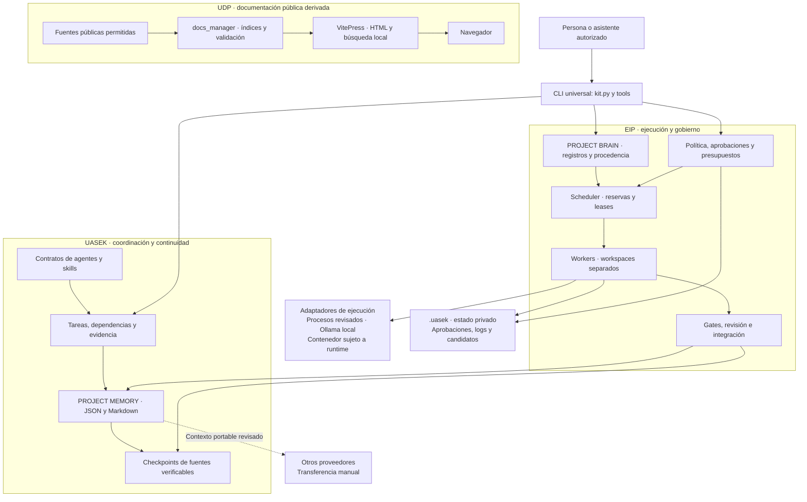
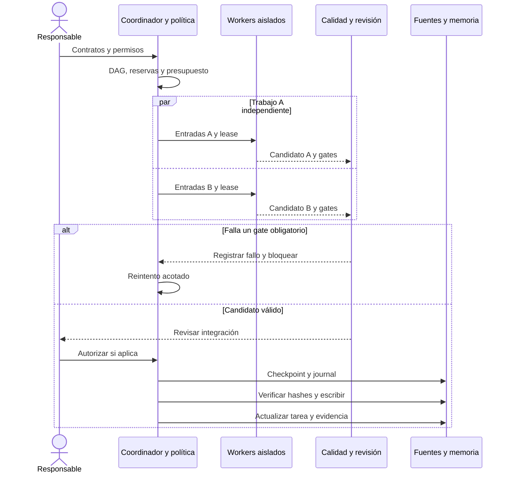
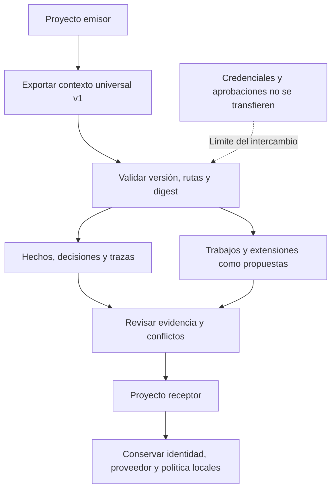
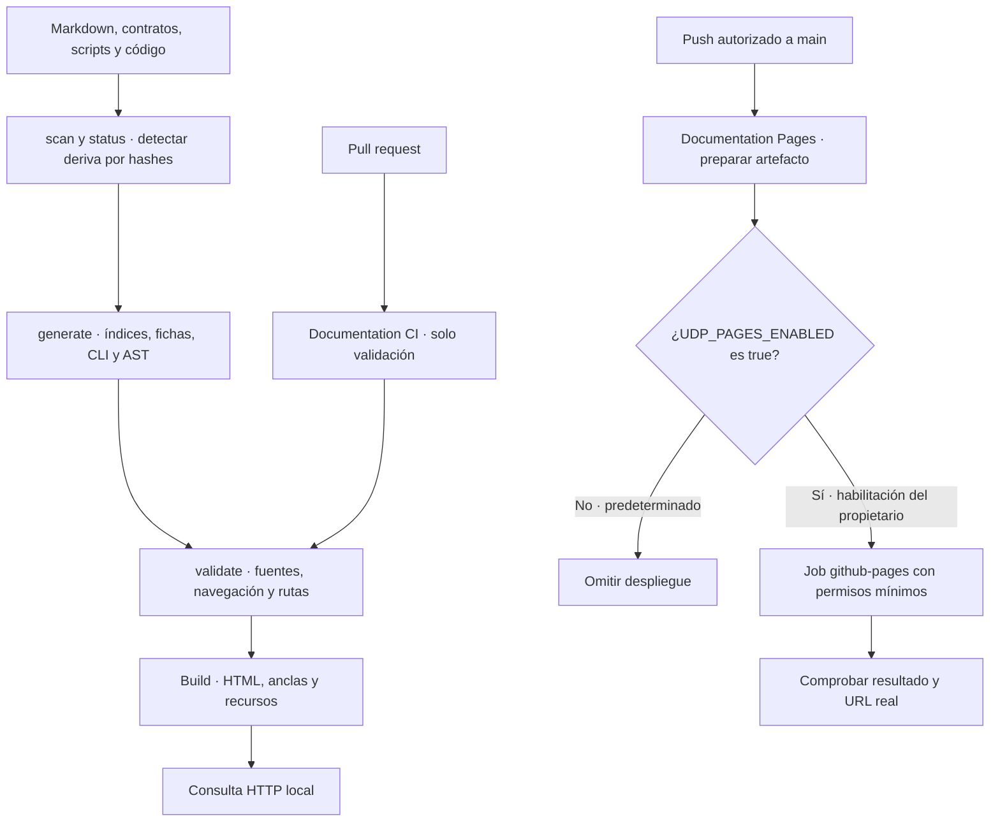

# PALLAQUINO TEAM

**Ingeniería de software asistida por IA, con memoria portable, coordinación de tareas y entregas verificables.**


[Inicio rápido](QUICKSTART.md) · [Manual de usuario](docs/user-manual/MANUAL.md) · [Plataforma EIP](docs/platform/PLATFORM.md) · [Portal documental](documentation/PORTAL_MANUAL.md) · [Validación](documentation/content/quality/validation.md)

> Un proyecto puede cambiar de asistente sin perder sus decisiones. El trabajo se organiza en contratos, dependencias, permisos y evidencia; los modelos y herramientas se incorporan mediante adaptadores reemplazables.

## Índice

- [Qué incluye](#overview)
- [Arquitectura](#architecture)
- [Stack tecnológico](#technology-stack)
- [Instalación y primer uso](#getting-started)
- [Coordinación y ciclo de trabajo](#workflow)
- [Memoria y continuidad](#project-memory)
- [Autonomía, calidad y seguridad](#governance)
- [Portal de documentación](#documentation-portal)
- [Estructura del repositorio](#repository-layout)
- [Validación y compatibilidad](#verification)
- [Contribuir y mantener](#contributing)

<a id="overview"></a>

## Qué incluye

PALLAQUINO TEAM integra tres capas complementarias. Conserva los identificadores técnicos `uasek` y `universal-ai-software-kit` para mantener compatibles la instalación, los comandos y los formatos existentes.

| Capa | Responsabilidad | Componentes |
|---|---|---|
| **Kit universal — UASEK** | Organizar el trabajo y conservar su continuidad | CLI Python, PROJECT MEMORY, perfiles, skills, plantillas, auditoría autorizada, pruebas y checkpoints |
| **Engineering Intelligence Platform — EIP** | Coordinar ejecución, revisión y gobierno | PROJECT BRAIN, dependencias, reservas de archivos, workers, permisos, quality gates, extensiones y gestión multiproyecto |
| **Universal Documentation Portal — UDP** | Convertir las fuentes en documentación navegable | Guías, catálogos derivados, referencia CLI/AST, búsqueda local, Mermaid, temas y workflows para GitHub Pages |

### Recursos disponibles

| Recurso | Cantidad | Fuente |
|---|---:|---|
| Perfiles de agentes | **21** | [Contratos y catálogo](configs/agents.json) |
| Skills operativas | **31** | [Instrucciones versionadas](skills/) |
| Referencias de sistemas por industria | **30** | [Catálogo de plantillas](configs/catalog.json) |
| Entradas de compatibilidad CLI | **16** | [Herramientas Python](tools/) |
| Administrador documental | **1** | [docs_manager.py](tools/docs_manager.py) |

Los perfiles son contratos de responsabilidad y entregables; su existencia no inicia modelos. Las referencias sectoriales son especificaciones adaptables, no aplicaciones comerciales implementadas.

<a id="architecture"></a>

## Arquitectura

El núcleo utiliza Python estándar y archivos abiertos. La ejecución, el estado privado y la documentación pública tienen responsabilidades separadas.



**Límite de publicación:** UDP no copia PROJECT MEMORY, aprobaciones, auditorías locales ni credenciales al portal. El ejecutor nativo exige código revisado; no es un sandbox para código hostil. Docker real requiere validación específica en el entorno donde se utilice.

<a id="technology-stack"></a>

## Stack tecnológico

Las versiones describen la configuración del repositorio; no indican necesariamente la última versión disponible de cada herramienta.

| Área | Tecnología | Versión o contrato | Uso |
|---|---|---|---|
| Núcleo | Python | `>=3.11`; validación local con `3.12.10` | CLI, memoria, análisis, coordinación y automatización |
| Runtime del núcleo | Biblioteca estándar | Sin dependencias externas obligatorias | Instalación local portable |
| Formatos | JSON, Markdown, SHA-256 | Memoria y contextos v1 | Estado versionable, intercambio e integridad |
| Build documental | Node.js / npm | Node `24.22.0` fijado en CI; npm `11.19.1` usado localmente | Instalación desde lockfile y generación estática |
| Motor documental | VitePress | `1.6.4` | Navegación, búsqueda local, resaltado y comandos copiables |
| Componentes | Vue | `3.5.44` | Tema, breadcrumbs, catálogo y diagramas |
| Diagramas | Mermaid | `12.2.0` | Arquitectura y flujos versionados como texto |
| Build revisado | Vite | `6.4.4` mediante `overrides` | Corrección de advisories heredados; compatibilidad comprobada con build y navegador |
| Pruebas | unittest | Incluido en Python | Comportamiento, recuperación, permisos y límites documentales |
| CI | GitHub Actions | Actions oficiales fijadas por SHA | Validación del núcleo y documentación |
| Hosting previsto | GitHub Pages | Artefacto estático y entorno `github-pages` | Preparado; deshabilitado hasta habilitación explícita |

El portal necesita Node.js; la CLI Python funciona sin instalar el stack web. Consulta la [decisión tecnológica UDP-001](documentation/ENGINE_DECISION.md).

<a id="getting-started"></a>

## Instalación y primer uso

### 1. Obtener el proyecto

```console
git clone https://github.com/jylmdev-cyber/pallaquino-team.git
cd pallaquino-team
python kit.py doctor
python kit.py --help
```

En Windows también puedes usar `py -3`; en Linux/macOS, `python3`. Git se necesita para clonar o auditar. El núcleo no requiere una cuenta de IA ni claves de API.

La instalación de la CLI es opcional:

```console
python -m pip install .
uasek --help
```

### 2. Crear un proyecto y definir una tarea

Desde la raíz del checkout, utilizando un destino nuevo:

```console
python kit.py init --destination ../mi-proyecto --name "Mi proyecto" --template inventory
python kit.py --root ../mi-proyecto task add --title "Definir alcance" --agent product-owner --acceptance "Actores, reglas y alcance revisados"
python kit.py --root ../mi-proyecto task ready
python kit.py --root ../mi-proyecto agent brief --task T0001
```

La plantilla `inventory` incorpora una referencia documental de inventarios. Implementar la aplicación y validar sus reglas de negocio sigue siendo responsabilidad del proyecto.

### 3. Activar EIP cuando se necesite

```console
python kit.py --root ../mi-proyecto platform init
python kit.py --root ../mi-proyecto platform plan --request "Agregar una API con autenticación" --max-roles 4
python kit.py --root ../mi-proyecto platform map
python kit.py --root ../mi-proyecto platform search --query "arquitectura"
```

La activación es por proyecto y comienza en modo **supervisado**. También aplica su política a los comandos anteriores y al administrador UDP. Los planes seleccionan roles por reglas explicables; planificar no concede permiso de ejecución.

### 4. Ejecutar la demostración comprobable

```console
python examples/platform/demo.py --destination ../demo-eip --approve-demo
```

La demo ejecuta dos scripts locales conocidos en paralelo, aplica gates y revisa sus resultados antes de integrar. Genera `OPERATIONS.html` en el proyecto de demostración. `--approve-demo` autoriza exclusivamente ese ejemplo; no eleva autonomía, conecta modelos ni despliega sistemas.

<a id="workflow"></a>

## Coordinación y ciclo de trabajo

Cada trabajo declara entradas, salidas, dependencias, entorno, comandos o requisitos de modelo, gates, timeout e intentos. El coordinador reserva archivos antes de ejecutar y conserva esas reservas durante revisión o conflicto.



Si dos trabajos comparten archivos incompatibles, el motor los serializa. Los conflictos se llevan a revisión. Los leases vencidos permiten recuperar tareas interrumpidas y descartar resultados tardíos.

La integración es atómica **por archivo**, no una transacción de varios archivos. Ante un fallo parcial, el journal y el checkpoint permiten preparar recuperación en una carpeta nueva. [Contratos de ejecución EIP](docs/platform/PLATFORM.md).

<a id="project-memory"></a>

## Memoria y continuidad

La continuidad no depende del historial de una conversación ni de que varios proveedores interpreten el mismo prompt interno.

| Componente | Qué conserva |
|---|---|
| PROJECT MEMORY | Requisitos, arquitectura, tareas, decisiones, evidencia y siguientes pasos |
| PROJECT BRAIN | Registros con procedencia, búsqueda léxica, trazas, relaciones y lecciones revisables |
| Contexto universal | Hechos y propuestas transportables con formato y checksum validados |
| Checkpoints | Fuentes seleccionadas, estado, decisiones, pruebas disponibles y resultado esperado |



```console
python kit.py --root ../mi-proyecto checkpoint create --label "Antes del cambio" --expected "Resultado verificable del trabajo"
python kit.py --root ../mi-proyecto checkpoint list
python kit.py --root ../mi-proyecto context export
python kit.py --root ../mi-proyecto handoff
```

Los snapshots excluyen binarios, bases, dependencias y secretos detectados; no sustituyen un backup de producción. Los hashes detectan corrupción, no autentican al remitente. La recuperación exige ejecutar pruebas de nuevo.

[Formato universal](docs/continuity/CONTEXT_FORMAT.md) · [Checkpoints y recuperación](docs/continuity/CHECKPOINTS.md)

<a id="governance"></a>

## Autonomía, calidad y seguridad

### Cuatro niveles de autonomía

| Nivel | Operaciones permitidas por la matriz sin aprobaciones adicionales de esas acciones |
|---|---|
| **Consultivo** | Lectura, búsqueda, planificación y consulta de calidad |
| **Supervisado** | Añade escritura de memoria y planes; ejecución e integración requieren aprobación |
| **Semiautónomo** | Añade ejecución, integración, invocación de modelos y preparación de recuperación |
| **Autónomo controlado** | Añade acciones de staging dentro de los límites de la política |

Producción, cambios de políticas/gates/modelos, instalación de extensiones, aprobación de lecciones y resolución de conflictos son acciones críticas que requieren revisión incluso en el nivel máximo. Las aprobaciones caducan, son de uso único y se ligan al proyecto, raíz, política y recurso.

### Controles aplicados

- Gates configurables: existencia de archivos, sintaxis Python, contenido esperado, posibles secretos y comandos de regresión.
- Cierre bloqueado si se incumplen criterios obligatorios o la evidencia dejó de coincidir.
- Presupuestos de workers, tiempo, intentos y unidades declaradas; estas unidades no equivalen a facturación real.
- Extensiones con API, versión, dependencias, capacidades y permisos explícitos; registrarlas no ejecuta código.
- Lecciones basadas en evidencia y revisión, sin modificar automáticamente políticas críticas.
- Separación lógica de proyectos, contexto importado sin permisos y auditoría local encadenada por hashes.

Para consultar una operación antes de autorizarla:

```console
python kit.py --root ../mi-proyecto --policy-preview test
python tools/docs_manager.py build --policy-preview
```

La detección de secretos es heurística. Las identidades de aprobación son declarativas locales; no sustituyen autenticación corporativa ni controles del sistema operativo. El contrato Docker falla sin runtime y no recurre al ejecutor nativo para código no revisado.

### Proveedores y herramientas

| Modalidad | Soporte real |
|---|---|
| Ollama local | Adaptador HTTP de texto; declarar modelo y capacidades antes de usar trabajos de inferencia |
| ChatGPT/OpenAI, Claude, Gemini y otros asistentes | Transferencia manual de contexto universal y encargos revisados |
| Nuevas herramientas y conectores | Contratos de extensión y adaptadores de proceso explícitamente revisados |

No se incluyen clientes cloud ejecutables para todos los proveedores. El routing usa capacidades y estimaciones declaradas de disponibilidad, costo y latencia; no consulta precios en vivo ni garantiza calidad semántica de las respuestas.

<a id="documentation-portal"></a>

## Portal de documentación

UDP reúne **217 páginas documentales**, más la página 404 del framework. Incluye guías, catálogos, referencia CLI y módulos, búsqueda sin backend, breadcrumbs, tabla de contenidos, anterior/siguiente, temas y diagramas con fuente textual.

### Generar y abrir localmente

Desde la raíz del checkout:

```console
python tools/docs_manager.py generate
cd documentation/portal
npm ci --ignore-scripts
npm run dev
```

Abre la URL local indicada por VitePress. Para validar y preparar el artefacto, vuelve a la raíz:

```console
python tools/docs_manager.py scan
python tools/docs_manager.py validate
python tools/docs_manager.py prepare-deploy
```

El build queda en `documentation/portal/.vitepress/dist/`. La preparación es local: no realiza commit, push, cambios remotos ni despliegue. Si EIP está activa, generar requiere `memory.write` y construir requiere `execute`, según la política.

### Documentación viva y publicación preparada



Las fuentes manuales se conservan. Una edición inesperada de una salida derivada bloquea su regeneración. La detección de deriva sugiere qué revisar; no demuestra la corrección semántica de cada documento.

**Estado de Pages:** preparado y deshabilitado por defecto. La base del proyecto es `/pallaquino-team/`; los sitios de usuario/organización admiten `/`. Las PR no publican. El job de despliegue exige `main` y `UDP_PAGES_ENABLED=true`; una ejecución manual exige además `publish=true`.

[Manual completo del portal](documentation/PORTAL_MANUAL.md) · [Decisión tecnológica](documentation/ENGINE_DECISION.md) · [Reporte UDP](documentation/content/quality/validation.md)

<a id="repository-layout"></a>

## Estructura del repositorio

```text
.
├── kit.py                         # CLI universal
├── uasek/                         # Núcleo Python y automatización documental
│   └── eip/                       # Brain, permisos, ejecución, gates y adaptadores
├── configs/                       # Catálogos, contratos y esquemas
├── agents/                        # Perfiles de responsabilidad
├── skills/                        # Instrucciones operativas
├── tools/                         # Entradas CLI y docs_manager.py
├── scripts/                       # Empaquetado de la distribución
├── templates/                     # Referencias adaptables de sistemas
├── examples/                      # Ejemplos y demostración EIP
├── tests/                         # Pruebas de núcleo, EIP, UDP y continuidad
├── project-memory/                # Estado y checkpoints versionables
├── docs/                          # Documentación fuente y evidencia revisada
├── documentation/
│   ├── content/                   # Guías manuales del portal
│   ├── portal/                    # VitePress, tema, componentes y lockfile
│   ├── scripts/                   # QA opcional con navegador
│   └── PORTAL_MANUAL.md            # Operación y publicación del portal
└── .github/workflows/             # Validación y preparación de GitHub Pages
```

`.uasek/`, `node_modules/`, builds, contenido derivado y reportes locales se excluyen de Git. El portal público excluye memorias y evidencias locales privadas. Los checkpoints de fuentes mantienen su procedencia e integridad.

<a id="verification"></a>

## Validación y compatibilidad

Última validación local documentada: **2026-10-21**, Windows, Python 3.12.10 y Node 24.22.0.

| Comprobación | Evidencia disponible |
|---|---|
| Suite completa | **137 pruebas: 136 aprobadas y 1 omitida** por privilegios de symlink en Windows |
| Distribución extraída | Misma suite ejecutada desde el ZIP, con huella de fuentes coincidente |
| Portal en navegador | Búsqueda, temas, móvil de 390 px, navegación, foco y zoom comprobados |
| Diagramas del portal | **71 renderizados en 37 páginas** en la validación UDP anterior a esta ampliación del README |
| Builds documentales | HTML, anclas y recursos comprobados bajo bases de proyecto y raíz |
| Dependencias web | Lockfile reproducible y auditoría npm sin vulnerabilidades reportadas en la ejecución documentada |
| CI | Matriz configurada para Windows, Linux y macOS; consultar resultados remotos en Actions |

```console
python kit.py test
python tools/docs_manager.py generate
python tools/docs_manager.py validate
python tools/docs_manager.py build
```

Las cifras describen una ejecución concreta, no una garantía permanente. WCAG 2.2 AA es un objetivo: las comprobaciones básicas de teclado, móvil y revisión visual no equivalen a certificación. Docker, modelos reales, producción y CI remota requieren evidencia específica antes de declararse validados.

[Validación UDP](documentation/content/quality/validation.md) · [Resumen de evidencia](docs/quality/evidence/udp-validation.json) · [Historial de versiones](docs/continuity/CHANGELOG.md)

<a id="contributing"></a>

## Contribuir y mantener

1. Definir alcance, responsable y criterio de aceptación.
2. Crear un checkpoint antes de cambios importantes y coordinar archivos compartidos.
3. Implementar y ejecutar pruebas adecuadas al comportamiento modificado.
4. Actualizar las fuentes documentales y regenerar el portal.
5. Revisar permisos, evidencia y contenido público antes de integrar o publicar.

La auditoría Git requiere autorización explícita del propietario; consultar ayuda no la concede. No incorporar credenciales, aprobaciones o datos privados a documentación, commits ni contratos. Las decisiones críticas conservan revisión humana.

[Guía para contribuir](documentation/content/development/contributing.md) · [Manual técnico](docs/technical-manual/MANUAL.md) · [Repositorio y autoría](docs/operations/REPOSITORY.md)

## Licencia

Distribuido bajo la [licencia MIT](LICENSE). Los componentes y referencias deben utilizarse respetando sus licencias y alcance documentado.
