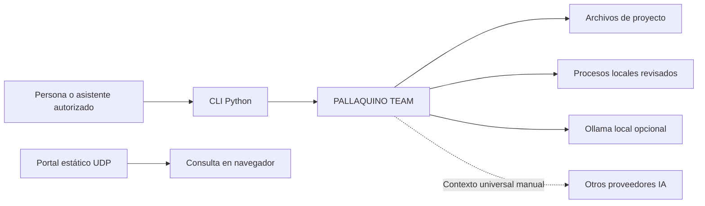
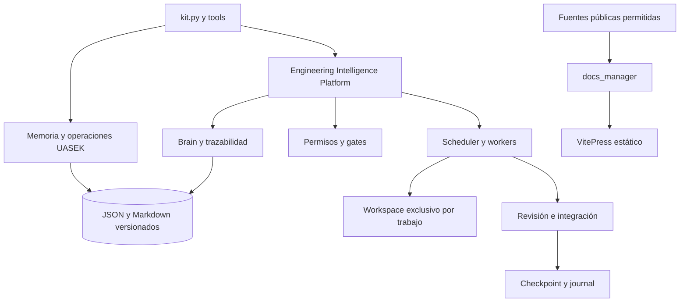
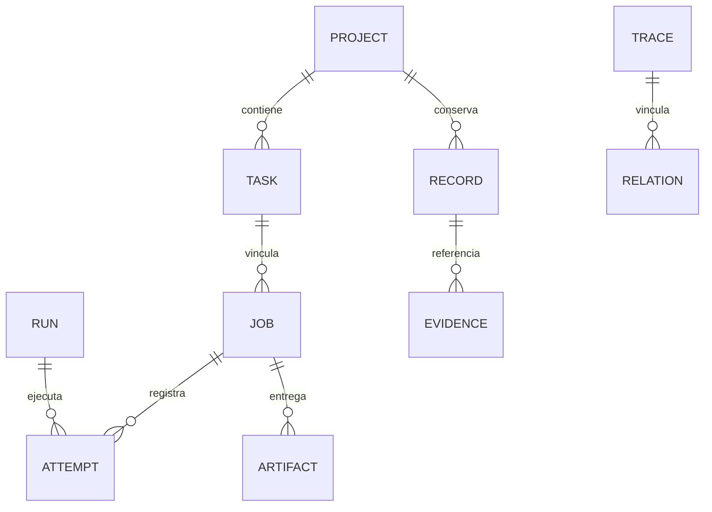

# Arquitectura de la plataforma

El núcleo es independiente del proveedor de IA. La CLI recibe una raíz de proyecto; las operaciones separan recursos del kit, memoria del proyecto y artefactos temporales. El portal es una capa estática derivada: no cambia el motor de ejecución ni recibe credenciales.

## Contexto C4

Representación de los límites implementados; los proveedores cloud se usan por transferencia manual, salvo que se incorpore un adaptador revisado.

## Contenedores y componentes C4

## Estructura de carpetas

| Carpeta | Responsabilidad |
|---|---|
| `uasek/` | Núcleo operativo y generador UDP |
| `uasek/eip/` | Estado, gobierno, ejecución, brain y adaptadores |
| `configs/` | Catálogos y esquemas versionados |
| `agents/`, `skills/` | Contratos e instrucciones |
| `tools/`, `scripts/` | Entradas CLI y empaquetado |
| `project-memory/` | Estado local y checkpoints; excluido del portal público |
| `.uasek/` | Workspaces y aprobaciones privadas; no versionado |
| `docs/` | Documentación fuente existente |
| `documentation/content/` | Guías manuales del portal |
| `documentation/portal/` | Framework, tema y contenido generado |

## Modelo de datos simplificado

Es un mapa lógico, no un esquema SQL. Las dependencias y relaciones se almacenan en JSON. La [referencia EIP](/generated/reference/docs/platform/PLATFORM.html) detalla nombres reales y restricciones.

## Decisiones y dependencias

Python estándar permite ejecutar el núcleo sin framework web ni base de datos. VitePress agrega dependencias solo al build documental, con versiones directas y lockfile fijados. Las instrucciones de proveedores se separan del contexto universal; importar hechos no importa permisos. La [decisión del motor](/generated/reference/documentation/ENGINE_DECISION.html) documenta las alternativas evaluadas.

[Manual técnico](/generated/reference/docs/technical-manual/MANUAL.html) · [Firmas extraídas del código](/generated/api/index.html)
