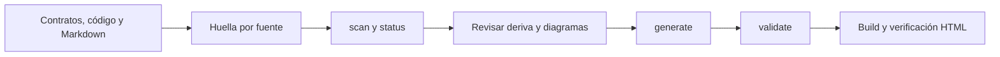

# Automatización reproducible

El núcleo ofrece entradas Python para inventario, estado, continuidad, seguridad, pruebas y entregas locales. La capa EIP coordina comandos estructurados con permisos, presupuestos y gates. Ningún script descubierto se ejecuta para generar su ficha.

## Referencias

- [Catálogo de scripts](/generated/scripts/index.html): propósito, ubicación, ayuda y argumentos.
- [CLI completa](/generated/cli/index.html): salida del parser real, sin duplicar sus opciones manualmente.
- [Orquestación adaptable](/generated/reference/docs/workflows/ADAPTIVE_ORCHESTRATION.html).
- [Motor EIP](/generated/reference/docs/platform/PLATFORM.html).

## Administrador de documentación

```console
python tools/docs_manager.py scan
python tools/docs_manager.py generate
python tools/docs_manager.py validate
python tools/docs_manager.py build
python tools/docs_manager.py status
python tools/docs_manager.py prepare-deploy
```

`scan` identifica fuentes modificadas, cobertura estructural y áreas potencialmente afectadas. `generate` reconstruye páginas e índices propios conservando las fuentes manuales. `validate` comprueba rutas y navegación; el build verifica además renderizado, enlaces HTML, anclas y recursos bajo la base de Pages. `prepare-deploy` prepara el mismo artefacto estático y nunca publica ni modifica Git.

## Sincronización documental



Las huellas detectan modificaciones; no prueban que un texto siga siendo correcto semánticamente. La actualización de decisiones arquitectónicas y diagramas exige revisión.
