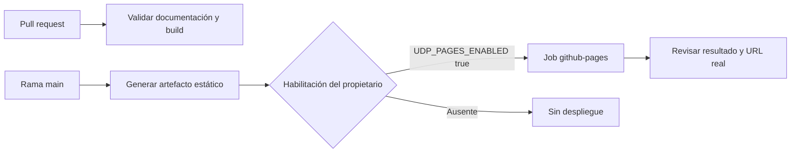

# Preparar GitHub Pages

::: info Estado de esta entrega
Portal público preparado; publicación deshabilitada por defecto. No se cambian configuraciones remotas ni se afirma una URL desplegada.
:::

## Flujo preparado



`.github/workflows/documentation-ci.yml` valida las PR sin publicar. `documentation-deploy.yml` prepara el artefacto desde `main`; el job de publicación exige `UDP_PAGES_ENABLED=true`. La ejecución manual requiere además el input `publish=true`. No hay despliegue desde PR.

## Preparar localmente

```console
python tools/docs_manager.py prepare-deploy
```

El resultado está en `documentation/portal/.vitepress/dist/`. El comando genera y valida, añade `.nojekyll` y devuelve un informe, sin subir archivos.

## Bases de URL

| Tipo de sitio | Configuración |
|---|---|
| Proyecto actual | Base `/pallaquino-team/` |
| Repositorio `propietario.github.io` | Base `/`, inferida de `GITHUB_REPOSITORY` |
| Dominio personalizado | `DOCS_BASE=/`, `DOCS_ORIGIN=https://docs.ejemplo.com` y DNS/CNAME revisados |

La URL prevista para el proyecto actual sería `https://jylmdev-cyber.github.io/pallaquino-team/`; es una configuración esperada, no evidencia de publicación.

## Habilitación posterior

Tras la autorización del propietario: configura Pages con Source **GitHub Actions**, revisa el entorno `github-pages`, protege sus despliegues y establece la variable de repositorio `UDP_PAGES_ENABLED=true`. La siguiente actualización autorizada de `main` podrá publicar. El [manual](/generated/reference/documentation/PORTAL_MANUAL.html) incluye primer despliegue, rollback y errores de rutas.

La CI y el despliegue remoto siguen pendientes de ejecución en GitHub. Un build local satisfactorio no garantiza permisos ni configuración de la cuenta remota.
