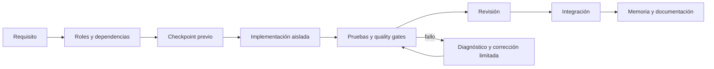
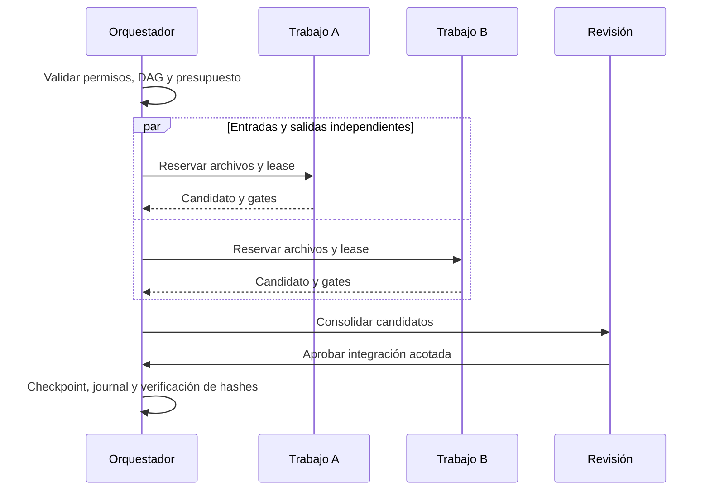

# Desarrollar con evidencia

## Un cambio de principio a fin



## Planificar

```console
python kit.py orchestrate --request "Agregar API con autenticación" --max-roles 4
python kit.py task ready
python kit.py agent list
```

El plan es una selección por reglas, no una autorización de ejecución. `--apply` crea tareas y un checkpoint; ajusta sus criterios al negocio antes de implementar. Los roles y skills disponibles están en los [catálogos](/generated/agents/index.html).

## Preparar y revisar

```console
python kit.py checkpoint create --label "Antes del cambio" --expected "Describir el resultado verificable"
python kit.py test
python tools/docs_manager.py scan
```

En EIP, declara entradas, salidas y gates. Los trabajos independientes usan workspaces separados; archivos compartidos conservan reservas hasta la revisión. Nunca edites simultáneamente los mismos archivos sin coordinación.

## Coordinación multiagente



## Actualizar documentación

Edita la fuente original en `docs/`, los contratos o las guías en `documentation/content/`. Después ejecuta `generate`, `validate` y `build`. `scan` detecta fuentes modificadas y sugiere revisar arquitectura cuando cambia el núcleo; no afirma comprender semánticamente cada decisión. Los cambios manuales en salidas generadas bloquean su sobrescritura.

[Guía de desarrollo existente](/generated/reference/docs/development/DEVELOPMENT_GUIDE.html) · [Contribuir](/development/contributing.html)
