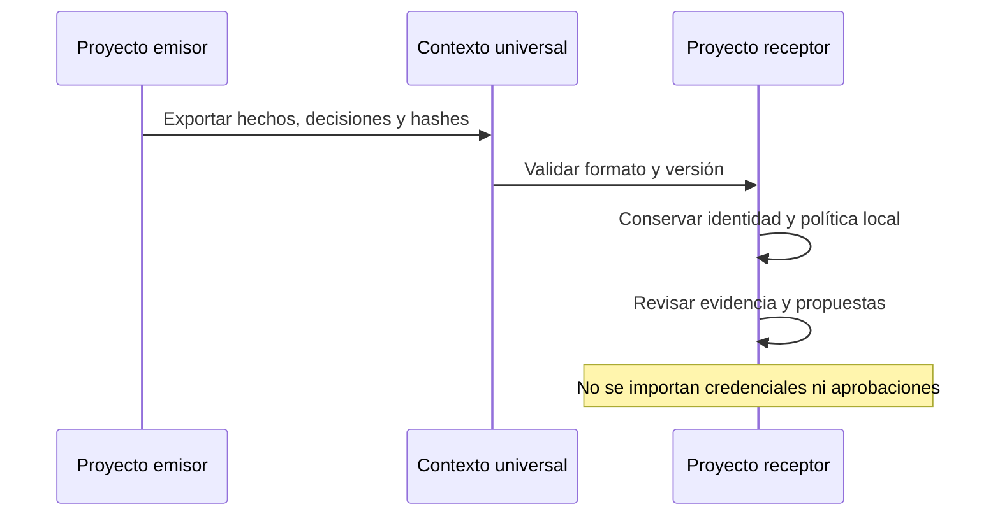
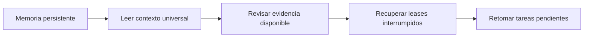

# Proveedores y continuidad

## Compatibilidad real

Ollama tiene un adaptador HTTP local de generación de texto. ChatGPT/OpenAI, Claude, Gemini, Copilot, Cursor, Windsurf y otros pueden recibir contexto universal mediante transferencia manual. No se incluyen clientes cloud ejecutables para todos los proveedores ni se cambia automáticamente la aplicación del usuario.

```console
python kit.py provider list
python kit.py context export
python kit.py handoff
```

Los permisos de un proyecto EIP activo también afectan estos comandos. Consulta `--policy-preview` cuando se necesite una aprobación.

## Transferencia neutral



La memoria clásica mantiene schema 1. El sidecar EIP transfiere registros, trazas y propuestas; no activa trabajos ni extensiones importadas. Un checksum detecta corrupción, no autentica al remitente. No se intenta imponer las mismas instrucciones internas a todos los modelos.

## Recuperar una sesión



Antes de continuar, valida versiones, raíces y disponibilidad de archivos. Los checkpoints restauran fuentes en una carpeta nueva y exigen volver a ejecutar pruebas. No reusan aprobaciones de otro proyecto o clon.

## Modelos y extensiones

La selección de modelos usa capacidades, complejidad, costo/latencia declarados, privacidad y herramientas. No es una consulta de precios en vivo. Las extensiones declaran API, versión, permisos y dependencias; registrarlas no ejecuta código. Las credenciales se gestionan fuera de memoria y contratos.

[Formato de contexto](/generated/reference/docs/continuity/CONTEXT_FORMAT.html) · [Proveedores existentes](/generated/reference/ai/adapters/README.html)
