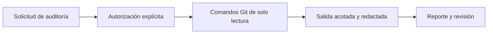

# Seguridad y gobierno

## Límites y autorizaciones

EIP aplica cuatro niveles: consultivo, supervisado, semiautónomo y autónomo controlado. Las acciones críticas, incluyendo producción, política, extensiones y resolución de conflictos, requieren revisión acotada. Las aprobaciones son de uso único, caducan y se ligan a proyecto, raíz local, política y recurso.

El ejecutor nativo exige código revisado y **no es un sandbox para código hostil**. El contrato Docker requiere imagen por digest, ausencia de red y límites; Docker real continúa pendiente de validación específica. Las aprobaciones son identidades declaradas localmente; no son autenticación corporativa.

## Auditoría Git

Consultar ayuda no concede autorización. Ejecutar `audit --authorize --full` solamente después de la instrucción explícita del propietario. El portal no ejecuta Git ni recoge el historial al generar contenido.

## Fuentes públicas y secretos

El generador permite documentos fuente, contratos, plantillas, scripts y firmas estáticas. Excluye `project-memory/`, `.uasek/`, evidencias locales de auditoría, `.env`, credenciales y resultados de ejecución. Los informes públicos resumen validación sin copiar datos privados. Los logs locales y la memoria permanecen fuera del build.

La detección de secretos es heurística. Revisa el artefacto antes de habilitar la publicación. El portal no utiliza analítica, buscadores externos ni fuentes remotas de tipografía.

## Dependencias y respuesta ante incidentes

Las dependencias web están fijadas en `package.json` y `package-lock.json`; usa `npm ci --ignore-scripts`. Revisa `npm audit` y actualiza mediante cambios revisados, repitiendo build y navegación. Si se filtra una credencial: revócala en su proveedor, limita acceso, revisa el alcance y elimina su exposición mediante el proceso autorizado; borrar una línea no revoca un secreto.

Las PR no confiables solo validan con permisos de lectura. No se usa `pull_request_target`, no se publican previews con secretos y el job Pages requiere la variable de habilitación y la rama principal.

[Políticas y límites detallados](/generated/reference/docs/platform/PLATFORM.html) · [Checklist existente](/generated/reference/docs/quality/SECURITY_CHECKLIST.html)
