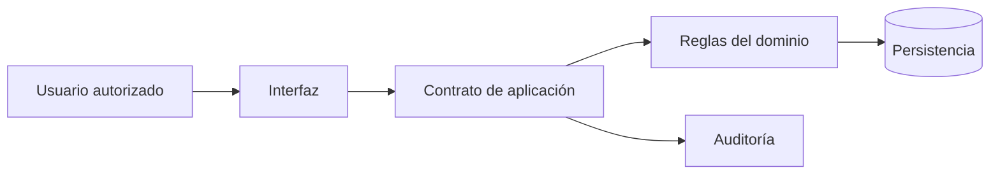
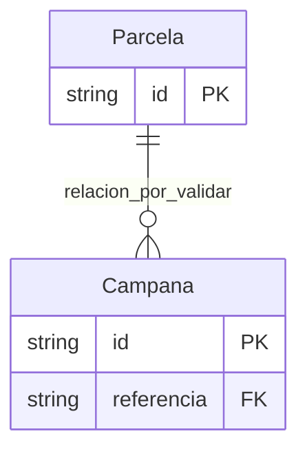

# Gestión agrícola y ganadera

Referencia adaptable de negocio; no es una aplicación implementada ni una arquitectura obligatoria.

## Negocio, objetivos y alcance

Registrar campañas y trazabilidad productiva. Objetivo: reducir registros inconsistentes y hacer trazables las operaciones. Primera entrega: flujo principal de principio a fin; integraciones y analítica avanzada se priorizan después de validar el flujo.

## Actores, roles y permisos

Productor, técnico, supervisor. Operadores crean registros de su ámbito; supervisores aprueban excepciones; auditores consultan historial sin modificarlo. Refinar matriz acción/recurso con el propietario del proceso; denegar acceso no asignado.

## Requisitos funcionales

- RF-01: Planificar campaña → registrar labores → cosechar → trazar lote.
- RF-02: consultar estado, historial y responsable de cada operación.
- RF-03: registrar excepciones con motivo y autorización.

## Requisitos no funcionales

- RNF-01: conservar integridad ante reintentos y concurrencia según la regla central.
- RNF-02: acordar carga, latencia p95, disponibilidad, RPO y RTO antes de elegir infraestructura. No hay valores asumidos.
- RNF-03: eventos de auditoría sin contraseñas ni contenido sensible innecesario.

## Regla central y caso de uso

BR-01: Cada tratamiento identifica lote, responsable e insumo utilizado.

Caso principal: Planificar campaña → registrar labores → cosechar → trazar lote. Precondición: actor autenticado y autorizado. Alternativa: datos inválidos o conflicto de estado produce error recuperable y no confirma parcialmente la operación.

## Historia y aceptación

Como productor, quiero completar el flujo principal para conocer su resultado y su historial.

- AC-01: con datos válidos y permisos, el flujo alcanza el estado final y registra responsable.
- AC-02: al repetir una operación confirmada, se respeta BR-01 y no se duplica su efecto.
- AC-03: un usuario sin permiso no puede operar ni consultar el recurso protegido.
- AC-04: un conflicto concurrente conserva BR-01 y devuelve una respuesta explicada al usuario.

## Módulos y arquitectura de referencia

Identidad/permisos, catálogo del dominio, operaciones, auditoría y reportes. Empezar con una aplicación modular y base transaccional cuando esas fronteras y transacciones se adecuen; separar servicios solo ante necesidades comprobadas.

## Modelo de datos inicial

Entidades: Parcela, Campana, Lote, Tratamiento. Cada registro persistente tiene identificador y versión para controlar concurrencia; los datos multiempresa incluyen tenant. Las relaciones exactas y retención se validan en descubrimiento.

## Endpoints de referencia

| Método | Ruta | Propósito |
|---|---|---|
| POST | /api/agriculture/operations | Solicitar operación validada e idempotente |
| GET | /api/agriculture/operations/{id} | Consultar resultado con autorización por objeto |
| GET | /api/agriculture/operations/{id}/history | Consultar historial autorizado |

Estos contratos son ilustrativos; no existen servidores ni endpoints implementados en el kit.

## Seguridad y normativa

Validar entradas, permisos por objeto, aislamiento y auditoría. Recoger país, sector, tipo de datos y retención; consultar fuentes oficiales o responsable legal antes de definir obligaciones. Sensores y clima; confirmar regulación de insumos local. No se declara cumplimiento normativo.

## Pruebas y plan de implementación

1. Confirmar actores, BR-01 y casos AC-01 a AC-04 con negocio.
2. Definir contratos y modelo con pruebas de integridad y concurrencia.
3. Implementar flujo principal con pruebas unitarias e integración.
4. Probar permisos y recuperación ante fallos; validar con usuario.
5. Conectar integraciones mediante sandbox, timeouts e idempotencia.
6. Medir carga representativa y preparar operación y recuperación.

## Integraciones y escalabilidad

Sensores y clima; confirmar regulación de insumos local. Aislar fallos externos mediante timeout y reintentos acotados solo para operaciones idempotentes. Medir consultas y colas antes de añadir caché o particionar; mantener la regla BR-01 al escalar.
